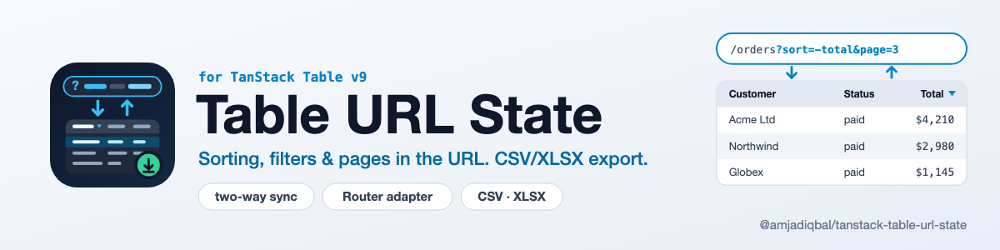

<p align="center">
  <picture>
    <source media="(prefers-color-scheme: dark)" srcset="art/banner-dark.png">
    
  </picture>
</p>

# TanStack Table URL State: search params sync and CSV/XLSX export for TanStack Table v9

Keep a **TanStack Table v9** table's sorting, column filters, global filter, pagination and
column visibility in the **URL search params**, so a filtered, sorted page can be bookmarked,
shared and restored with the back button. Works with **TanStack Router** or with
plain `URLSearchParams` and `window.history`. Export the current view to **CSV**, or to **XLSX**
from a separate entry that you load only when someone clicks Export.

[](https://www.npmjs.com/package/@amjadiqbal/tanstack-table-url-state)
[](https://bundlejs.com/?q=@amjadiqbal/tanstack-table-url-state)
[](LICENSE.md)

```
/orders?sort=-total&f.status=paid&q=acme&page=3&hide=placed
```

- **Two-way sync.** Table changes update the URL; back/forward and links update the table.
- **Short URLs.** Defaults are left out of the URL. Sorting is `sort=-total,customer`, filters are one readable param each (`f.status=paid`), and non-string values are JSON (`f.total=[100,5000]`).
- **Debounced typing.** Filter input reaches the URL after 300 ms; sorting and paging are written at once.
- **TanStack Router adapter** that writes through `router.navigate`, plus a `validateSearch` helper.
- **CSV export** of what the user sees: visible columns, filtered and sorted rows, your formatters.
- **XLSX export** as an optional entry (`/xlsx`), so the main bundle stays small.
- **Typed**, ESM-only, `sideEffects: false`, no telemetry, no network calls.

Community package, not affiliated with TanStack. See the [TanStack Table docs](https://tanstack.com/table).

## Install

```bash
npm i @amjadiqbal/tanstack-table-url-state
```

Peer dependencies: `react >= 18`, `@tanstack/react-table` 9.x, and optionally
`@tanstack/react-router` 1.x for the Router adapter.

## Quick start (no router)

```tsx
import { useTable } from '@tanstack/react-table'
import { useTableUrlState } from '@amjadiqbal/tanstack-table-url-state'

function Orders({ data }: { data: Order[] }) {
  const { tableOptions } = useTableUrlState()
  const table = useTable({ features, columns, data, ...tableOptions })
  // render as usual
}
```

`tableOptions` holds the `state` and `on…Change` handlers for the synced slices. Register the
matching v9 features (`rowSortingFeature`, `columnFilteringFeature`, `globalFilteringFeature`,
`rowPaginationFeature`, `columnVisibilityFeature`) and their row models as you normally would.

If the table also has state of its own, merge it:

```tsx
const table = useTable({
  features, columns, data,
  ...tableOptions,
  state: { ...tableOptions.state, rowSelection },
  onRowSelectionChange: setRowSelection,
})
```

## TanStack Router

```tsx
import { createFileRoute } from '@tanstack/react-router'
import { useTableUrlState } from '@amjadiqbal/tanstack-table-url-state'
import { useTanStackRouterAdapter, validateTableSearch } from '@amjadiqbal/tanstack-table-url-state/router'

const tableSearch = validateTableSearch()

export const Route = createFileRoute('/orders')({
  // Keep the table's params when the route has its own search schema.
  validateSearch: (search) => ({ ...tableSearch(search), ...mySchema.parse(search) }),
  component: Orders,
})

function Orders() {
  const adapter = useTanStackRouterAdapter()
  const { tableOptions } = useTableUrlState({ adapter })
  const table = useTable({ features, columns, data, ...tableOptions })
  // ...
}
```

The adapter reads the router's location and navigates to the same route with the new search, so
`useSearch()` and anything else that reads the router's search see every change. Because the router reads search values as
JSON, `?page=3` arrives in `useSearch()` as the number `3`.

For server-side data, read the same params in your loader (`page`, `size`, `sort`, `q`, `f.<id>`)
or decode them with `decodeState` from the `/core` entry.

## Options

```ts
useTableUrlState({
  adapter,               // default: window.history + URLSearchParams
  prefix: 'orders.',     // two tables on one page: orders.sort, orders.page, ...
  keys: { globalFilter: 'search' },  // rename params
  defaults: {            // values that are never written to the URL
    pagination: { pageIndex: 0, pageSize: 25 },
    columnVisibility: { internalNotes: false },
  },
  slices: ['sorting', 'pagination'], // sync only some slices
  debounceMs: 300,       // filter typing delay; 0 writes at once
  history: 'replace',    // or 'push' to add back-button entries
})
```

It returns `{ state, tableOptions, reset }`. `reset()` restores the defaults and removes this
table's params, leaving every other param alone.

**Page resets.** When pagination is synced, `tableOptions` turns off Table's `autoResetPageIndex`
and the hook returns to page 1 itself when the user sorts or filters. That way a shared link,
back/forward, or data that loads after mount keeps `page=` instead of jumping to page 1. Pass
your own `autoResetPageIndex` after the spread if you want Table's behaviour back.

| State | Param | Example |
|---|---|---|
| sorting | `sort` | `sort=-total,customer` (`-` = descending) |
| global filter | `q` | `q=acme` |
| column filter | `f.<columnId>` | `f.status=paid`, `f.total=[100,5000]` |
| page | `page` | `page=3` (1-based) |
| page size | `size` | `size=50` |
| hidden columns | `hide` | `hide=placed,email` |

A string filter that looks like another type is quoted so it reads back as a string
(`f.code="42"`). Malformed params (`page=abc`) are ignored, not thrown.

### Other routers

Pass any object with `read`, `write` and `subscribe`:

```ts
import type { UrlAdapter } from '@amjadiqbal/tanstack-table-url-state/core'

const adapter: UrlAdapter = {
  read: () => Object.fromEntries(searchParams),
  write: (patch, { history }) => { /* set or delete each key, then navigate */ },
  subscribe: (listener) => { /* call listener when the URL changes */ return () => {} },
}
```

The `/core` entry (codec and history adapter) has no React import, so it can be reused outside React.

## Export

```tsx
import { downloadCsv } from '@amjadiqbal/tanstack-table-url-state'

<button onClick={() => downloadCsv(table, { filename: 'orders.csv' })}>Export CSV</button>
```

XLSX loads on demand:

```tsx
<button
  onClick={async () => {
    const { downloadXlsx } = await import('@amjadiqbal/tanstack-table-url-state/xlsx')
    downloadXlsx(table, { filename: 'orders.xlsx', sheetName: 'Orders' })
  }}
>
  Export XLSX
</button>
```

Both take the same options:

| Option | Default | |
|---|---|---|
| `rows` | `'filtered'` | `'filtered'`: all rows that pass the filters, sorted, across pages. `'page'`: the rows on screen. `'all'`: ignore filters and sorting. |
| `columns` | visible data columns | Column ids, in order. Display columns (checkboxes, actions) are skipped by default. |
| `header` | string `header`, else id | `(column) => string` |
| `format` / `formatters` | none | `(value, { row, column }) => unknown`, for all columns or per column id |

CSV also has `delimiter`, `newline` (`\r\n`), `bom` (for Excel) and `escapeFormulas` (on: text
cells starting with `= + - @` get a leading `'` so spreadsheets do not run them). Use `toCsv` /
`toXlsx` for the text or bytes without downloading. XLSX keeps numbers, booleans and dates as
real cell types and freezes a bold header row.

## Moving from tanstack-table-search-params

`tanstack-table-search-params` targets Table v8. With v9:

- `useTableSearchParams(router)` becomes `useTableUrlState({ adapter })`; spread `tableOptions` instead of the returned object.
- `paramNames` becomes `keys` (or `prefix` for several tables); `defaultValues` becomes `defaults`; `enabled` becomes `slices`; `debounceMilliseconds` becomes `debounceMs` (filters only).
- URLs differ (`sort=-total` instead of JSON), so old bookmarks fall back to the defaults.

## What's tested

- 46 unit tests (Vitest + jsdom): the codec (round trips, defaults, prefixes, malformed input), the
  React hook with a real `useTable` from `@tanstack/react-table` 9.3.1 and `window.history`,
  the Router adapter with a real TanStack Router 1.170 router, back/forward and deep links that
  keep the page, CSV quoting and formula escaping, and the XLSX file structure.
- Tried by hand in a Vite + TanStack Router app in Chrome: see the release notes for what was checked.
- Not covered yet: TanStack Start (SSR) apps, Solid/Vue/Svelte adapters, React Router or Next.js adapters (use a custom
  adapter), server-side query building, and SSR without the Router adapter (the history adapter
  reads nothing on the server, so the first render uses the defaults).

## Support

- 🐛 **Bug or feature request**: [open an issue](https://github.com/amjadiqbal/tanstack-table-url-state/issues)
- 🔒 **Security issue**: please report privately via GitHub's security tab

## Need this built into your app, or something custom?

I build data-heavy React and TanStack apps: admin tables, server-side filtering, exports, dashboards.
[Get in touch](https://amjad.com.pk/contact?utm_source=github&utm_medium=readme&utm_campaign=tanstack-table-url-state).

[](https://www.upwork.com/freelancers/amjadkhatri)

## More packages

Part of a family of open-source packages. See [all of them](https://github.com/amjadiqbal?tab=repositories).

| | |
|---|---|
| [query-key-kit](https://github.com/amjadiqbal/query-key-kit) | Typed query keys for TanStack Query v5 |
| [start-seo-kit](https://github.com/amjadiqbal/start-seo-kit) | SEO meta, sitemap and robots for TanStack Start |

## Licence

MIT. See [LICENSE.md](LICENSE.md).
